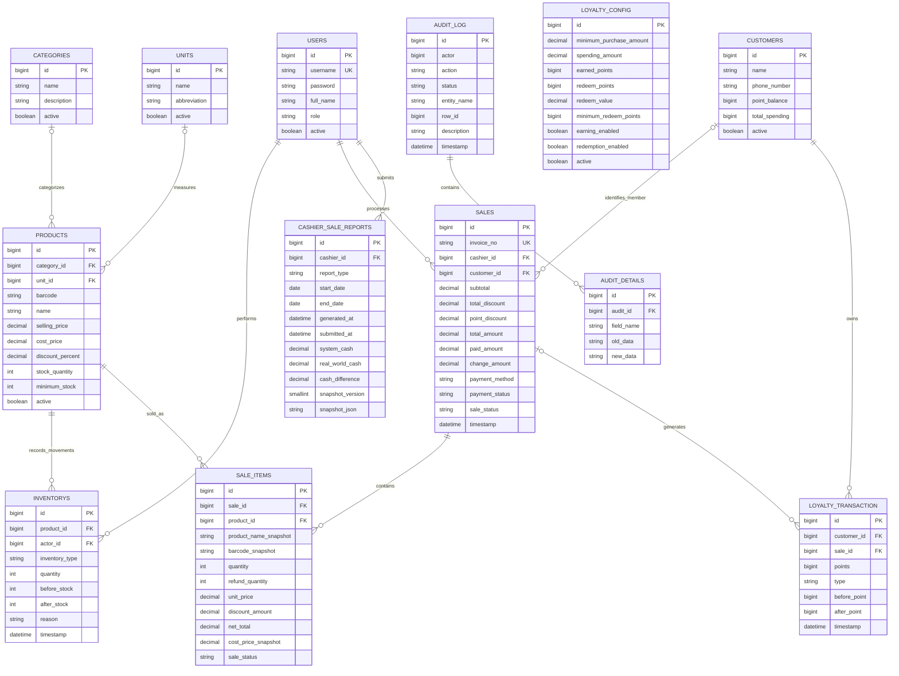

# LocalMart POS Entity–Relationship Model

| Document | Value |
| --- | --- |
| Version | 2.0 — implementation baseline |
| Updated | 26 October 2026 |
| Scope | Persistent JPA entities in the completed application |
| Related documents | `POS-DataDictionary.md`, `POS_Project_SRS_Documentation.md` |

## 1. Purpose

This document describes the database model implemented by LocalMart POS. It replaces the earlier six-entity draft and removes questionnaire-related entities that do not exist in this project.

## 2. Entity–Relationship Diagram

## 3. Entity Summary

| Entity / table | Responsibility |
| --- | --- |
| `User` / `users` | Authentication, role, activation, and user audit metadata. |
| `Category` / `categories` | Product grouping. |
| `Unit` / `units` | Product unit of measure. |
| `Product` / `products` | Product master data, pricing, discount, and current stock. |
| `Customer` / `customers` | Member identity, spending, and loyalty balance. |
| `Inventory` / `inventorys` | Stock movement ledger for stock-in, sales, refunds, adjustments, damage, expiry, and missing stock. |
| `Sale` / `sales` | Transaction header, payment totals, status, customer, cashier, and loyalty summary. |
| `SaleItem` / `sale_items` | Transaction lines and immutable commercial snapshots. |
| `LoyaltyConfig` / `loyalty_config` | Versioned earning and redemption rules. |
| `LoyaltyTransaction` / `loyalty_transaction` | Point movement ledger. |
| `Audit` / `audit_log` | Successful or failed business-operation audit event. |
| `AuditDetails` / `audit_details` | Field changes and structured event details. |
| `CashierSaleReport` / `cashier_sale_reports` | Immutable owner-scoped cashier reconciliation report and JSON snapshot. |

## 4. Cardinality and Optionality

| Relationship | Cardinality | Implementation meaning |
| --- | --- | --- |
| Category → Product | 1 → 0..N; category optional on product | A category can group many products. Product creation workflows normally assign one. |
| Unit → Product | 1 → 0..N; unit optional on product | A unit can be reused by many products. |
| Product → Inventory | 1 → 0..N | Every inventory movement references exactly one product. |
| User → Inventory | 1 → 0..N | Every inventory movement references exactly one actor. |
| User → Sale | 1 → 0..N | Every sale references exactly one cashier/actor. |
| Customer → Sale | 0..1 → 0..N | A sale may be anonymous or linked to one active member. |
| Sale → SaleItem | 1 → 0..N at schema level | Checkout requires at least one item at the application layer. |
| Product → SaleItem | 1 → 0..N | Each sale item references its product and also stores value snapshots. |
| Customer → LoyaltyTransaction | 1 → 0..N | Every point movement belongs to one customer. |
| Sale → LoyaltyTransaction | 0..1 → 0..N | A point movement may be associated with a sale. |
| Audit → AuditDetails | 1 → 0..N | An audit event may contain field-level changes or structured refund data. |
| User → CashierSaleReport | 1 → 0..N | Every saved cashier report has one owner. |

## 5. Logical References Not Enforced as Foreign Keys

- `audit_log.actor` stores a user ID as a scalar for durable audit history.
- `created_by`, `updated_by`, and `deleted_by` inherited from `BaseEntity` store actor IDs as scalars.
- `audit_log.row_id` is polymorphic: its target is identified by `entity_name`, so it cannot be represented by one database FK.
- `cashier_sale_reports.snapshot_json` contains detached sale, item, payment, and refund details. These snapshot references are historical values rather than relational FKs.

## 6. Refund Persistence Model

There is no standalone refund entity. A processed refund updates and records data across existing entities:

1. `sales.sale_status` becomes `PARTIALLY_REFUNDED` or `REFUNDED`.
2. `sale_items.refund_quantity` and item status reflect returned quantities.
3. `inventorys` records `REFUND`, `DAMAGE`, or `EXPIRED` return outcomes.
4. `loyalty_transaction` records earned-point reversals or redeemed-point restoration.
5. `audit_log` and `audit_details` preserve the refund amount, reasons, conditions, quantities, payment method, and item allocation used by cashier reporting.

## 7. Database-Level Uniqueness

- `users.username`
- `sales.invoice_no`
- (`cashier_sale_reports.cashier_id`, `start_date`, `end_date`)

Category names, unit names/abbreviations, active customer phone numbers, and active product barcodes are enforced by application services rather than database unique constraints.
