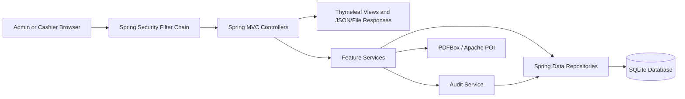

# LocalMart POS Software Requirements Specification

| Document | Value |
| --- | --- |
| Version | 2.0 — as-built specification |
| Status | Completed implementation baseline |
| Updated | 26 October 2026 |
| Product | LocalMart POS |
| Related documents | `POS-DataDictionary.md`, `POS-ER-Diagram.md`, project `README.md` |

## 1. Introduction

### 1.1 Purpose

LocalMart POS is a Spring Boot point-of-sale application for a single small retail business. It provides authenticated sales processing, inventory tracking, customer membership and loyalty, refunds, audit history, and role-specific reporting through a browser interface backed by a local SQLite database.

This document describes the behavior that is implemented in the current codebase. Statements marked “shall” describe the completed product baseline, not an unimplemented roadmap.

### 1.2 Product Scope

The implemented system includes:

- form-login authentication and `ADMIN`/`CASHIER` authorization;
- user administration and password reset;
- product, category, and unit master data;
- customer/member records and cashier member lookup;
- POS checkout with product discounts and optional loyalty redemption;
- cash, card, and QR payment recording;
- receipt display, cashier sales history, and dashboard totals;
- refund processing with reason and physical return condition;
- manual and spreadsheet-based stock-in;
- stock adjustments and a searchable inventory movement ledger;
- loyalty configuration and point transaction history;
- barcode lookup and a wired USB scanner portal;
- success/failure audit events with field-level detail;
- admin sales, payment, and profit reporting with XLSX/PDF exports;
- cashier daily, weekly, and custom reconciliation reports with immutable snapshots and PDF export.

### 1.3 Explicit Boundaries

- The application is designed for one store and one SQLite database; branch synchronization is not implemented.
- Taxes are not calculated by the current checkout implementation.
- Card and QR are recorded payment methods. The application does not contact a bank, card network, QR provider, or payment gateway.
- A non-cash refund is recorded in the POS; external fund reversal remains an operational responsibility.
- Database backup and restore workflows are not implemented, although a local `backups` directory is created at startup.
- The core server and database are local, but current templates load Bootstrap and Bootstrap Icons from jsDelivr. Full visual styling therefore depends on network access unless those assets are cached or later bundled locally.
- Automatic browser opening uses the macOS `open` command. Failure to open a browser does not stop the Spring Boot server.

### 1.4 User Roles

| Role | Description |
| --- | --- |
| `ADMIN` | Manages users and catalog configuration, sees audit and administrative reports, configures loyalty, and can access shared operational modules. |
| `CASHIER` | Processes sales and refunds, looks up members and products, performs currently shared inventory/customer operations, and creates owner-scoped cashier reports. |

## 2. Product Overview

### 2.1 Runtime Model

LocalMart POS runs as a Java 21 Spring Boot 4 application. Thymeleaf renders server-side HTML, Spring Security manages authenticated sessions and CSRF protection, Spring Data JPA/Hibernate persists data to SQLite, and JavaScript supports interactive checkout, stock, report, and scanner workflows.

### 2.2 Technology Stack

| Layer | Technology |
| --- | --- |
| Runtime | Java 21 |
| Application framework | Spring Boot 4.1 |
| Web UI | Spring MVC, Thymeleaf, HTML, CSS, JavaScript |
| Security | Spring Security, BCrypt password hashing |
| Persistence | Spring Data JPA, Hibernate, SQLite JDBC |
| Spreadsheet processing | Apache POI |
| PDF generation | Apache PDFBox with bundled Noto Sans/Thai fonts |
| Build | Maven Wrapper |
| Tests | JUnit/Spring Boot Test, Mockito, Node test runner for cashier report JavaScript |

### 2.3 Architecture



The backend is organized by feature under `com.localmarts.pos`: `audit`, `category`, `customer`, `inventory`, `loyalty`, `product`, `report`, `sale`, `scanner`, `unit`, and `user`. Controllers handle HTTP concerns, services enforce business rules and transactions, repositories provide persistence, entities define the schema, and DTO/model packages isolate request and report data.

### 2.4 Storage and Configuration

Default profile:

- Server: `0.0.0.0:8080`
- URL: `https://localhost:8080`
- TLS keystore: `${user.home}/LocalMartPOS/certs/pos-https.p12`
- SQLite database: `${user.home}/LocalMartPOS/database/localmart-pos.db`
- Startup-created directories: `database`, `backups`, `exports`, and `logs` under `${user.home}/LocalMartPOS`

Demo profile (`--spring.profiles.active=demo`):

- Server: `127.0.0.1:8080`
- URL: `http://127.0.0.1:8080`
- TLS: disabled
- SQLite database: `${user.home}/Library/Application Support/LocalMart POS Demo/database/demo.db`

Hibernate uses `spring.jpa.hibernate.ddl-auto=update`.

## 3. Authorization Model

The following table reflects `SecurityConfig` route matching order.

| Access | Route families |
| --- | --- |
| Public | `/`, `/login`, `/css/**`, `/js/**`, `/images/**` |
| Admin only | `/admin/**`, `/users/**`, `/products/**`, `/unit/**`, `/category/**`, `/audit/**`, `/loyalty-config/**` |
| Cashier only | `/cashier/reports/**` |
| Admin or Cashier | `/inventory/**`, `/customer/**`, `/pos/scanner/**`, and other `/cashier/**` routes |
| Any authenticated user | Any unmatched route, including `/loyalty` |

After login, admins are redirected to `/admin`; other authenticated users are redirected to `/cashier`. Logout returns to the login page.

## 4. Functional Requirements

### 4.1 Authentication and User Administration

| ID | Implemented requirement |
| --- | --- |
| AUTH-01 | The system shall authenticate users by username and BCrypt-hashed password. |
| AUTH-02 | The system shall reject inactive accounts. |
| AUTH-03 | The system shall enforce route authorization for `ADMIN` and `CASHIER`. |
| AUTH-04 | The system shall preserve CSRF protection for state-changing form requests. |
| AUTH-05 | The system shall support authenticated logout. |
| USER-01 | Admins shall list active and inactive users. |
| USER-02 | Admins shall create users with an assigned role. |
| USER-03 | Admins shall edit user profile and role data. |
| USER-04 | Admins shall activate and deactivate users. |
| USER-05 | Admins shall reset a user's password. |
| USER-06 | Usernames shall be unique. |
| USER-07 | The system shall audit successful and failed user-management changes. |

At first startup, the application creates bootstrap accounts only if they are absent:

| Username | Initial password | Role |
| --- | --- | --- |
| `admin` | `admin123` | `ADMIN` |
| `cashier` | `cashier123` | `CASHIER` |

These bootstrap passwords must be changed before operational use.

### 4.2 Catalog Management

| ID | Implemented requirement |
| --- | --- |
| CAT-01 | Admins shall create, edit, list, and soft-delete products. |
| CAT-02 | Products shall support name, barcode, size, manufacturing/expiry dates, category, unit, selling price, cost price, minimum stock, and discount percentage. |
| CAT-03 | Active product barcodes shall be unique at the service layer. |
| CAT-04 | Admins shall create, edit, list, and soft-delete categories. |
| CAT-05 | Active category names shall be case-insensitively unique. |
| CAT-06 | A category referenced by a product shall not be deleted. |
| CAT-07 | Admins shall create, edit, list, and soft-delete units. |
| CAT-08 | Active unit names and abbreviations shall be case-insensitively unique. |
| CAT-09 | A unit referenced by a product shall not be deleted. |
| CAT-10 | Catalog changes and failures shall be audited. |

### 4.3 Customer Management

| ID | Implemented requirement |
| --- | --- |
| CUS-01 | Authorized users shall list and search customer records. |
| CUS-02 | Authorized users shall create, edit, and soft-delete customers through `/customer/**`. |
| CUS-03 | Active customer phone numbers shall be unique at the service layer. |
| CUS-04 | New customers shall begin with zero point balance and zero total spending. |
| CUS-05 | Cashiers shall search active members by name or phone number and view an owner-safe member detail page. |

### 4.4 Inventory Management

| ID | Implemented requirement |
| --- | --- |
| INV-01 | The system shall maintain a movement ledger with before-stock, after-stock, type, quantity, reason, actor, and timestamp. |
| INV-02 | Authorized users shall filter and page inventory history by keyword, movement type, and actor where supported. |
| INV-03 | Authorized users shall perform manual stock-in with a positive quantity. |
| INV-04 | Authorized users shall perform manual adjustments for supported adjustment types. |
| INV-05 | Stock-reducing operations shall reject quantities that would make stock negative. |
| INV-06 | Checkout shall record `SALE` inventory movements. |
| INV-07 | Sellable returns shall restore stock and record `REFUND` movements. |
| INV-08 | Damaged and expired returns shall record traceable zero-stock-impact movements without restoring sellable stock. |
| INV-09 | The system shall provide an XLSX stock-in template. |
| INV-10 | The system shall parse uploaded XLSX/XLS files, validate headers and rows, classify existing/new/unmapped/invalid rows, permit review, and atomically apply confirmed valid rows. |
| INV-11 | Uploaded batch review state shall be isolated in the user's HTTP session and removable through cancel. |

### 4.5 Sales and Payments

| ID | Implemented requirement |
| --- | --- |
| SALE-01 | A checkout request shall contain at least one item. |
| SALE-02 | The system shall resolve active products and combine duplicate product quantities in the cart. |
| SALE-03 | Checkout shall reject missing, inactive, invalidly priced, or insufficient-stock products. |
| SALE-04 | The system shall calculate gross subtotal, product discount, optional loyalty discount, final total, payment, and change with two-decimal money precision. |
| SALE-05 | The system shall support `CASH`, `CARD`, and `QR` payment recording. |
| SALE-06 | Cash paid shall be at least the final total; card and QR paid amounts shall equal the final total. |
| SALE-07 | A completed checkout shall persist a unique invoice, sale header, and sale-item snapshots. |
| SALE-08 | Checkout shall decrement product stock and record inventory movements in the same transaction. |
| SALE-09 | An active member may be attached to a sale. |
| SALE-10 | The system shall update applicable loyalty balances and transactions during checkout. |
| SALE-11 | Cashiers shall view today's completed-sale count, today's revenue, and recent sales. |
| SALE-12 | Cashiers shall view paginated personal sales history and authorized receipts. |
| SALE-13 | Sale notes shall be limited to 500 characters. |

### 4.6 Refunds and Returns

| ID | Implemented requirement |
| --- | --- |
| REF-01 | Authorized users shall search eligible sales by invoice/customer criteria. |
| REF-02 | A sale shall be refundable for seven days from purchase time in the `Asia/Bangkok` timezone. |
| REF-03 | The system shall permit at most one refund operation per sale. |
| REF-04 | A refund may return selected quantities from one or more sale items and shall not exceed sold quantities. |
| REF-05 | The operator shall confirm physical receipt of the returned items. |
| REF-06 | Each returned quantity shall be allocated to a reason and condition; breakdown quantities shall equal the selected refund quantity. |
| REF-07 | Refund amounts shall be reconstructed from immutable sale-item price and discount snapshots. |
| REF-08 | Refund processing shall update sale/item statuses and inventory atomically. |
| REF-09 | Refund processing shall reverse earned points and restore redeemed points where applicable, rejecting unsafe historical loyalty data for manual review. |
| REF-10 | The system shall persist structured refund audit details used by reporting. |
| REF-11 | Cash refunds shall instruct the cashier to return cash physically; card/QR reversals shall be recorded only, with no external processor call. |

### 4.7 Loyalty

| ID | Implemented requirement |
| --- | --- |
| LOY-01 | Admins shall configure minimum purchase, spending step, earned points, redemption step/value, minimum redeem balance, and earning/redemption enablement. |
| LOY-02 | The system shall provide a default configuration when no configuration exists. |
| LOY-03 | Eligible member sales shall earn points according to the configuration applicable at sale time. |
| LOY-04 | A member may redeem eligible points as a checkout discount when redemption is enabled. |
| LOY-05 | Point movements shall record before and after balances. |
| LOY-06 | Refunds shall produce explicit earning-reversal and redemption-restoration transactions. |
| LOY-07 | Authorized users shall view and filter loyalty transaction history. |
| LOY-08 | Loyalty configuration changes shall be audited. |

### 4.8 Audit Logging

| ID | Implemented requirement |
| --- | --- |
| AUD-01 | The system shall record `CREATE`, `UPDATE`, and `DELETE` events with `SUCCESS` or `FAILED` status. |
| AUD-02 | Audit events shall identify the actor, logical entity, optional row, description, and timestamp. |
| AUD-03 | Field-level old/new values may be attached as audit details. |
| AUD-04 | Refund processing shall store structured item and return details in the audit detail collection. |
| AUD-05 | Only admins shall access the audit browser. |

### 4.9 Administrative Reporting

| ID | Implemented requirement |
| --- | --- |
| AR-01 | Admins shall view a report dashboard with current-day sales and profit summaries. |
| AR-02 | Admins shall select inclusive report start and end dates; omitted dates shall resolve to a valid default period. |
| AR-03 | Sales reporting shall show transaction, revenue, average-sale, discount, and cashier breakdown information. |
| AR-04 | Profit reporting shall use sale-item cost snapshots and display summary, time trend, and product performance. |
| AR-05 | Product performance shall be sortable by profit or units. |
| AR-06 | Payment reporting shall aggregate recorded payment methods and amounts. |
| AR-07 | Sales data shall be exportable to XLSX with optional cashier filtering. |
| AR-08 | A combined administrative report shall be exportable to XLSX or PDF for the selected period. |
| AR-09 | PDF generation shall support Latin and Thai text with bundled fonts. |

### 4.10 Cashier Reconciliation Reporting

| ID | Implemented requirement |
| --- | --- |
| CR-01 | Cashiers shall generate owner-scoped `DAILY`, trailing-seven-day `WEEKLY`, or `CUSTOM` report previews. |
| CR-02 | Future-only periods and invalid/reversed dates shall be rejected. |
| CR-03 | A preview shall summarize transactions, charged sales, discounts, refunds, retained amount, average value, best seller, payment receipts/refunds/net, and system cash. |
| CR-04 | The report shall use selected sales plus structured refund audit events processed by the cashier during the period. |
| CR-05 | Preview state shall be detached from JPA entities, bound to the current actor and session, and protected by a random token. |
| CR-06 | The cashier shall enter non-negative real-world cash with at most two decimal places before submission. |
| CR-07 | The system shall calculate cash difference and classify it as `OVER`, `SHORT`, or `BALANCED`. |
| CR-08 | Only one saved report may exist per cashier and inclusive start/end date pair. |
| CR-09 | Saved reports shall be immutable versioned JSON snapshots using timezone `Asia/Bangkok` and currency `THB`. |
| CR-10 | A cashier shall only list, view, or download their own saved reports. |
| CR-11 | Saved cashier reports shall be downloadable as PDF with sale, item, refund, payment, and reconciliation detail. |

### 4.11 Barcode Scanner

| ID | Implemented requirement |
| --- | --- |
| SCN-01 | Authorized users shall access a scanner portal. |
| SCN-02 | The scanner lookup endpoint shall search active, non-deleted products by barcode. |
| SCN-03 | Lookup shall return a usable product result or an appropriate not-found/bad-request response. |

## 5. External Interface Requirements

### 5.1 User Interface

- Server-rendered Thymeleaf pages shall provide role-aware navigation and form workflows.
- The interface shall support contemporary desktop browsers; layouts also target tablet-sized displays.
- Client-side JavaScript shall assist with cart calculations, refund breakdowns, inventory upload/review, stock adjustment, scanner interaction, and cashier cash reconciliation.
- Receipts shall be printable from the browser.

### 5.2 File Interfaces

- Inventory import accepts Excel workbooks in `.xlsx` format with the expected stock-in headers.
- Inventory template and admin report exports use XLSX.
- Admin combined reports and saved cashier reports support PDF.
- Uploaded files are limited by Spring configuration to 10 MB per file/request.

### 5.3 Hardware Interfaces

- Keyboard or barcode-wedge input can be used in product search fields.
- The scanner portal accepts input from a wired USB barcode scanner operating as a keyboard.
- Receipt printing uses the browser/operating-system print path; there is no direct printer-driver integration.

### 5.4 External Services

No external business service is required for persistence, payment, loyalty, reports, or authentication. Current pages reference jsDelivr for Bootstrap assets as described in §1.3.

## 6. Data Requirements

The persistent model consists of 13 tables:

1. `users`
2. `categories`
3. `units`
4. `products`
5. `customers`
6. `inventorys`
7. `sales`
8. `sale_items`
9. `loyalty_config`
10. `loyalty_transaction`
11. `audit_log`
12. `audit_details`
13. `cashier_sale_reports`

Detailed fields, types, nullability, enums, and invariants are defined in `POS-DataDictionary.md`; relationships are defined in `POS-ER-Diagram.md`.

## 7. Non-Functional Requirements

### 7.1 Security

- Passwords shall be stored as BCrypt hashes.
- Authenticated sessions and Spring Security authorization shall protect non-public routes.
- CSRF protection shall remain enabled for form submissions.
- Administrative reports, catalog configuration, user management, loyalty configuration, and audit logs shall be admin-only.
- Saved cashier reports shall be owner-scoped in both service queries and controller access.
- Production/default operation shall use the configured HTTPS keystore.

### 7.2 Integrity and Reliability

- Checkout, refund, batch stock-in, inventory mutations, and loyalty mutations shall use transactional service boundaries where implemented.
- Stock shall not become negative through supported workflows.
- Historical sale items shall retain commercial snapshots even when product master data later changes.
- Saved cashier reports shall remain immutable and independently readable through a versioned snapshot codec.
- Duplicate cashier report submission shall be prevented by both service checks and a database unique index.
- Invalid or inconsistent historical refund data shall fail report generation explicitly rather than silently producing incorrect totals.

### 7.3 Performance

- Product, customer, sale, audit, inventory, and loyalty list screens shall use filtered or paginated repository queries where implemented.
- Dashboard queries shall limit recent-sales results.
- Report calculations shall execute against local SQLite data and avoid external network calls.
- Spreadsheet and PDF generation shall occur on demand in the application process.

### 7.4 Usability

- Validation failures shall return actionable messages without committing partial business changes.
- Search shall support the identifiers operators commonly have available: product name/barcode, customer name/phone, and invoice information.
- Cash reconciliation shall display both system cash and counted real-world cash before submission.
- Date-range report screens shall expose common date shortcuts and reject invalid ranges.

### 7.5 Maintainability and Testability

- Code shall remain grouped by feature and responsibility.
- Business calculations shall remain in services/model objects rather than templates.
- Repository and service behavior shall be testable independently, with integration tests covering persistence-sensitive sales, refund, inventory, loyalty, and report behavior.
- Report JavaScript calculations shall remain covered by the Node test suite.

## 8. Build and Verification

Java build and tests:

```bash
./mvnw test
```

Cashier report JavaScript tests:

```bash
node --test src/test/js/cashier-report.test.cjs
```

Run with the default profile:

```bash
./mvnw spring-boot:run
```

Run with the demo profile:

```bash
./mvnw spring-boot:run -Dspring-boot.run.profiles=demo
```

## 9. Traceability Notes

- Authorization rules: `config/SecurityConfig.java`
- Persistent model: entity classes plus `common/BaseEntity.java`
- Checkout and payment rules: `sale/SaleService.java`
- Refund and return rules: `sale/RefundService.java`
- Inventory import and mutation rules: `inventory/service/*`
- Loyalty rules: `loyalty/service/*`
- Admin reporting: `report/admin/*`
- Cashier reporting: `report/cashier/*`
- Runtime paths and profiles: `application.yml` and `application-demo.yml`
